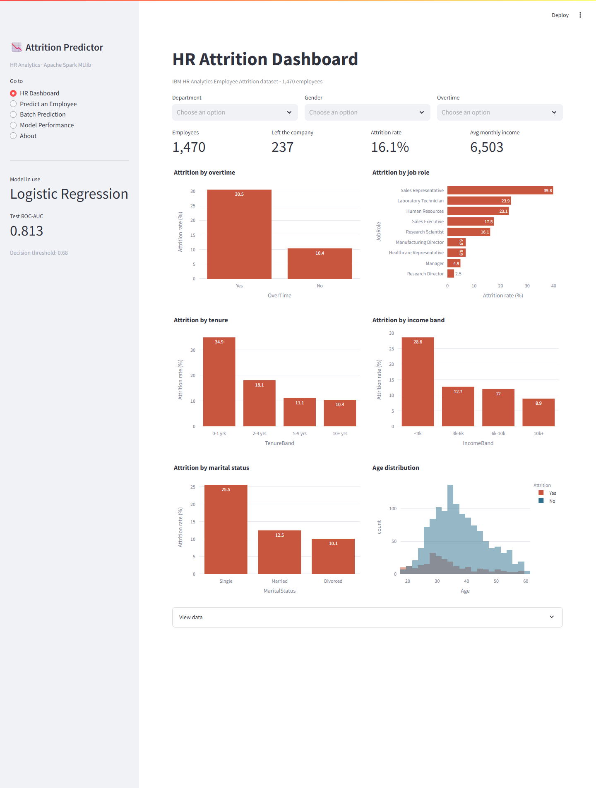

# Employee Attrition Prediction using HR Analytics

**Industry domain:** HR Analytics · **Stack:** Apache Spark 3.5 (PySpark, Spark SQL, MLlib) · Streamlit · Python 3.11

Predicts which employees are likely to leave, explains *why* for each person, and suggests an HR
action for each risk driver. The whole pipeline (cleaning, analysis, feature engineering,
training, tuning and scoring) runs on Apache Spark, so the same code scales from a laptop to a
cluster.

> CA 3 project, B.Tech Computer Science and Engineering, Symbiosis Institute of Technology, Nagpur.
> Course: Big Data Analytics (Course Code: 0705210731) · Academic Year 2026-27 · Batch 2023-27
> Varun Mundhada (PRN 23070521184) · Institute Guide: Dr. Dharamveer Chaudhary



## Features

| Page | What it does |
|---|---|
| **HR Dashboard** | Headcount, leavers, attrition rate; interactive charts by overtime, role, tenure, income, marital status and age; department / gender / overtime filters |
| **Predict an Employee** | Form for one employee → probability of leaving, Low / Medium / High risk band, top risk drivers with a suggested HR action for each |
| **Batch Prediction** | Upload a CSV of employees (or use the sample) → everyone scored with Spark, risk-band summary, ranked table, downloadable results |
| **Model Performance** | Comparison of all four models, ROC curve, confusion matrix, feature importance |

## Results

Dataset: [IBM HR Analytics Employee Attrition & Performance](https://www.kaggle.com/datasets/pavansubhasht/ibm-hr-analytics-attrition-dataset):
1,470 employees, 35 attributes, 16.1% attrition. Stratified 85 / 15 development / test split.
Every model is tuned with 5-fold cross-validation and class weights on the development set. The
threshold is chosen from out-of-fold predictions, the model is selected by CV AUC, and the test
set is used once.

| Model | CV AUC | Test AUC | Test F1 (tuned threshold) | Test F1 (0.5) |
|---|---|---|---|---|
| **Logistic Regression** (selected) | **0.839** | 0.813 | 0.540 | 0.535 |
| Random Forest | 0.804 | 0.839 | 0.556 | 0.528 |
| Gradient-Boosted Trees | 0.774 | 0.827 | 0.519 | 0.568 |
| Decision Tree | 0.679 | 0.807 | 0.506 | 0.451 |

Selected model on the test set (threshold 0.68): accuracy 84.6%, precision 52.6%, recall 55.6%.
At threshold 0.5 it catches 75% of leavers with more false alarms, so the threshold is a business
choice. The test set has only 36 leavers, so test AUC moves by several points between splits.
The cross-validated AUC is the steadier estimate. The split is hash-based, so these numbers are
reproduced exactly on every run.

**Strongest drivers** (logistic-regression coefficients). These raise the risk ▲: years since
the last promotion, overtime, frequent travel, many previous employers, distance from home.
These lower it ▼: a high satisfaction index, years with the current manager, years in the
current role, environment satisfaction.

**Key analysis findings (Spark SQL):** overtime workers leave at 30.5% vs 10.4%; first two years
at the company 34.9%; income under 3k 28.6%; sales representatives 39.8%; no stock options 24.4%.

**Scalability:** the same pipeline was trained on data enlarged up to 500× (~735,000 rows) with no
code change. See `reports/figures/17_scalability.png` and `models/scale_benchmark.json`.

## Project structure

```
data/                  IBM HR dataset + sample_employees.csv for batch scoring
src/
  config.py            paths, column lists, feature-engineering SQL
  spark_session.py     local SparkSession (handles Windows set-up)
  preprocess.py        load, clean, stratified split, class weights, MLlib feature pipeline
  eda.py               Spark SQL analysis → reports/figures + models/eda_summary.json
  train.py             CV grid search for 4 models, OOF threshold, test evaluation, save best
  predict.py           AttritionPredictor: scoring, risk bands, what-if explanation; CLI
  scale_benchmark.py   timing on synthetically enlarged data
app/streamlit_app.py   web application
models/                saved Spark PipelineModel + metrics
reports/figures/       all charts
scripts/               diagrams, screenshots, report assets, PPT builder
tests/                 pytest tests
report/                LaTeX project report (SIT format) + compiled PDF
ppt/                   presentation
```

## How to run

**Prerequisites:** Python 3.11, Java 17 (`JAVA_HOME` set, or Temurin installed in the default
folder). On **Windows**, Spark also needs `winutils.exe` and `hadoop.dll` (Hadoop 3.3) in
`%USERPROFILE%\hadoop\bin` to save models. They're available from
[cdarlint/winutils](https://github.com/cdarlint/winutils/tree/master/hadoop-3.3.6/bin).

```bash
git clone https://github.com/varunmundhada/employee-attrition-prediction.git
cd employee-attrition-prediction
python -m venv .venv
.venv\Scripts\activate            # Linux / macOS: source .venv/bin/activate
pip install -r requirements.txt

python -m src.eda                 # Spark SQL analysis + charts            (~1 min)
python -m src.train               # train, tune, compare, save best model  (~30-40 min)
python -m pytest -q               # tests
streamlit run app/streamlit_app.py    # open http://localhost:8501
```

A trained model is already included in `models/`, so you can start the app straight away.

On Windows you can also double-click `setup.bat`, then `run_pipeline.bat`, then `run_app.bat`.

Other commands:

```bash
python -m src.predict data/sample_employees.csv predictions.csv   # score a CSV from the command line
python -m src.scale_benchmark                                       # scalability test
```

## Method in brief

1. **Clean**: drop constant columns (EmployeeCount, Over18, StandardHours), label Yes → 1.
2. **Engineer features** inside the pipeline (`SQLTransformer`): IncomePerJobLevel, TenureRatio,
   YearsPerCompany, PromotionGap, SatisfactionIndex.
3. **MLlib pipeline**: StringIndexer → OneHotEncoder → VectorAssembler → StandardScaler → classifier.
4. **Imbalance**: leavers weighted by the stayers / leavers ratio (`weightCol`).
5. **Tune**: `CrossValidator` (5 folds, ROC-AUC) over a grid for each model.
6. **Threshold**: maximise F1 on out-of-fold predictions of the development set.
7. **Explain**: for one employee, reset each factor to the typical value of employees who
   stayed and re-score. The drop in risk is that factor's contribution.

## License

Educational project. Dataset © IBM, published on Kaggle for public use.
